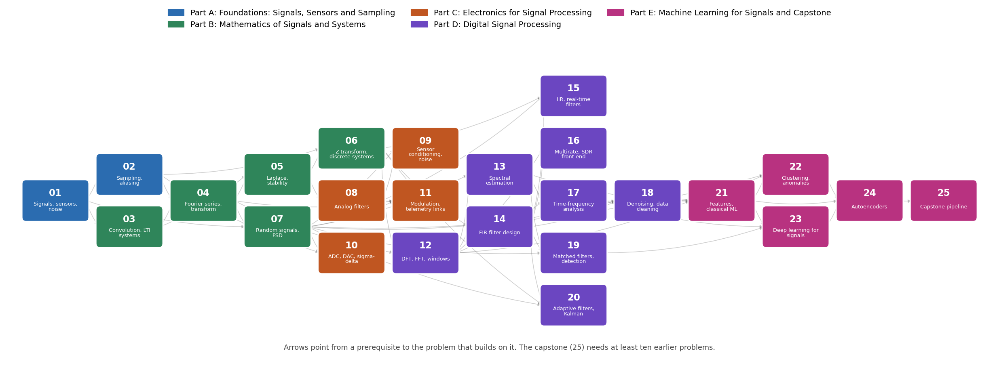

# Signal Processing Ladder: 25 Hands-On Problem Statements from Sensors to Machine Learning

**Aeronautics and Space Technology Club, IIT (ISM) Dhanbad**

A progressive, hands-on problem set in **signal processing for aerospace**: from the first noisy sensor reading to filters,
spectra, detection theory, Kalman filtering and machine learning on real astronomical and flight-style data. It contains
**25 professionally typeset problem statements** (PDF + LaTeX), a Python helper package with **seeded synthetic datasets of known
ground truth**, a repository structure for pushing your solutions, and tools to track progress. It was built for learning *by
solving*: every problem asks you to derive a result by hand, implement the method yourself, validate it against a known answer,
and carry the result to an engineering decision for a satellite, a rocket, a ground station or a detector.

The problem statements follow a hackathon-style format (Background, Theoretical Framework, Data and Simulation Specification,
Tasks, Aerospace Application Link, Deliverables, Learning Resources, Evaluation), so what you learn here transfers directly to
competition problem solving and to real project work.

---

## Table of contents

1. [Overview](#1-overview)
2. [The ladder at a glance](#2-the-ladder-at-a-glance)
3. [Roadmap](#3-roadmap)
4. [What you will learn: theory and hands-on practice](#4-what-you-will-learn-theory-and-hands-on-practice)
5. [Repository layout](#5-repository-layout)
6. [Getting started](#6-getting-started)
7. [How to work on a problem](#7-how-to-work-on-a-problem)
8. [Data: synthetic and real](#8-data-synthetic-and-real)
9. [Study paths and schedule](#9-study-paths-and-schedule)
10. [Submitting solutions with git](#10-submitting-solutions-with-git)
11. [Self-assessment rubric](#11-self-assessment-rubric)
12. [Rules of the house](#12-rules-of-the-house)
13. [Rebuilding the PDFs](#13-rebuilding-the-pdfs)
14. [Reading list](#14-reading-list)
15. [FAQ and troubleshooting](#15-faq-and-troubleshooting)

---

## 1. Overview

The goal is to make you fundamentally strong in signal processing through problem solving rather than passive reading. Each
problem is designed as a small research project:

| Phase | What you do |
|---|---|
| **Think** | Read the theory, derive the analytic results by hand, write down the model, the units and the sampling rates. |
| **Build** | Implement the method yourself; validate against the analytic results and the self-check targets. |
| **Experiment** | Run sweeps, stress tests and the real data; produce first plots and numbers with error bars. |
| **Refine** | Fix weaknesses, write an honest analysis and a short memo, tidy the folder. |

Five principles run through the whole ladder (details in [`docs/CURRICULUM.md`](docs/CURRICULUM.md)):

1. **Derive by hand, then verify by code.** Each problem has analytic results and self-check numbers that your code must reproduce.
2. **Real problems, real data, known truth.** Every problem has a synthetic generator with ground truth (so you can measure
   bias, error and false alarms) *and* pointers to real datasets (so you see what the textbook model leaves out).
3. **Each problem hands numbers to the next.** The noise densities of problem 01 become the Kalman filter's process noise in 20;
   the windows of 12 become the spectral estimators of 13; the matched filter of 19 is the benchmark for the networks of 23.
4. **Aerospace first.** Every problem ends with an Aerospace Application Link: gyro drift budgets, reaction-wheel aliasing,
   apogee detection, GPS outages, CubeSat link budgets, burst triggers.
5. **Honesty over hype.** Error bars, false-alarm rates and injection–recovery curves are required, and machine learning is
   always compared with a classical optimum.

Total estimated effort: about **390 hours** (25 problems; the capstone alone is 35–60 hours).

## 2. The ladder at a glance

| # | Problem | Level | Effort | Prerequisites | Statement |
|---|---|---|---|---|---|
| | **Part A: Foundations: Signals, Sensors and Sampling** | | | | |
| 01 | Signals, Sensors and Noise | 1 | 8–12 hours | none | [PDF](problems/01_signals_sensors_and_noise/01_signals_sensors_and_noise.pdf) · [LaTeX](problems/01_signals_sensors_and_noise/01_signals_sensors_and_noise.tex) |
| 02 | Sampling, Aliasing and Reconstruction | 1 | 8–12 hours | 01 | [PDF](problems/02_sampling_aliasing_and_reconstruction/02_sampling_aliasing_and_reconstruction.pdf) · [LaTeX](problems/02_sampling_aliasing_and_reconstruction/02_sampling_aliasing_and_reconstruction.tex) |
| | **Part B: Mathematics of Signals and Systems** | | | | |
| 03 | Complex Numbers, Convolution and LTI Systems | 1 | 10–14 hours | 01 | [PDF](problems/03_convolution_and_lti_systems/03_convolution_and_lti_systems.pdf) · [LaTeX](problems/03_convolution_and_lti_systems/03_convolution_and_lti_systems.tex) |
| 04 | Fourier Series and the Fourier Transform | 2 | 10–14 hours | 02, 03 | [PDF](problems/04_fourier_series_and_transform/04_fourier_series_and_transform.pdf) · [LaTeX](problems/04_fourier_series_and_transform/04_fourier_series_and_transform.tex) |
| 05 | Laplace Transform, Poles and Stability | 2 | 10–14 hours | 03, 04 | [PDF](problems/05_laplace_transform_and_stability/05_laplace_transform_and_stability.pdf) · [LaTeX](problems/05_laplace_transform_and_stability/05_laplace_transform_and_stability.tex) |
| 06 | Z-Transform and Discrete-Time Systems | 2 | 10–14 hours | 02, 05 | [PDF](problems/06_z_transform_and_discrete_systems/06_z_transform_and_discrete_systems.pdf) · [LaTeX](problems/06_z_transform_and_discrete_systems/06_z_transform_and_discrete_systems.tex) |
| 07 | Random Signals, Noise and Power Spectral Density | 2 | 12–16 hours | 01, 04 | [PDF](problems/07_random_signals_and_noise_spectra/07_random_signals_and_noise_spectra.pdf) · [LaTeX](problems/07_random_signals_and_noise_spectra/07_random_signals_and_noise_spectra.tex) |
| | **Part C: Electronics for Signal Processing** | | | | |
| 08 | Analog Filters: From RC to Butterworth and Chebyshev | 2 | 10–14 hours | 05 | [PDF](problems/08_analog_filters/08_analog_filters.pdf) · [LaTeX](problems/08_analog_filters/08_analog_filters.tex) |
| 09 | Sensor Conditioning and Circuit Noise | 3 | 12–16 hours | 07, 08 | [PDF](problems/09_sensor_conditioning_and_circuit_noise/09_sensor_conditioning_and_circuit_noise.pdf) · [LaTeX](problems/09_sensor_conditioning_and_circuit_noise/09_sensor_conditioning_and_circuit_noise.tex) |
| 10 | ADC and DAC: Quantisation and Sigma-Delta | 2 | 10–14 hours | 02, 07 | [PDF](problems/10_adc_dac_and_quantisation/10_adc_dac_and_quantisation.pdf) · [LaTeX](problems/10_adc_dac_and_quantisation/10_adc_dac_and_quantisation.tex) |
| 11 | Modulation, Demodulation and Telemetry Links | 3 | 14–18 hours | 04, 07, 08 | [PDF](problems/11_modulation_and_telemetry_links/11_modulation_and_telemetry_links.pdf) · [LaTeX](problems/11_modulation_and_telemetry_links/11_modulation_and_telemetry_links.tex) |
| | **Part D: Digital Signal Processing** | | | | |
| 12 | DFT, FFT and Windowing | 2 | 12–16 hours | 04, 06 | [PDF](problems/12_dft_fft_and_windowing/12_dft_fft_and_windowing.pdf) · [LaTeX](problems/12_dft_fft_and_windowing/12_dft_fft_and_windowing.tex) |
| 13 | Spectral Estimation: Welch, Multitaper and Lomb–Scargle | 3 | 12–16 hours | 07, 12 | [PDF](problems/13_spectral_estimation/13_spectral_estimation.pdf) · [LaTeX](problems/13_spectral_estimation/13_spectral_estimation.tex) |
| 14 | FIR Filter Design | 2 | 12–16 hours | 06, 12 | [PDF](problems/14_fir_filter_design/14_fir_filter_design.pdf) · [LaTeX](problems/14_fir_filter_design/14_fir_filter_design.tex) |
| 15 | IIR Filters and Real-Time Implementation | 3 | 12–16 hours | 06, 08, 14 | [PDF](problems/15_iir_filters_and_real_time_implementation/15_iir_filters_and_real_time_implementation.pdf) · [LaTeX](problems/15_iir_filters_and_real_time_implementation/15_iir_filters_and_real_time_implementation.tex) |
| 16 | Multirate Processing and SDR Front Ends | 3 | 12–16 hours | 12, 14 | [PDF](problems/16_multirate_processing/16_multirate_processing.pdf) · [LaTeX](problems/16_multirate_processing/16_multirate_processing.tex) |
| 17 | Time–Frequency Analysis: STFT, Wavelets and Chirps | 3 | 14–18 hours | 12, 13 | [PDF](problems/17_time_frequency_analysis/17_time_frequency_analysis.pdf) · [LaTeX](problems/17_time_frequency_analysis/17_time_frequency_analysis.tex) |
| 18 | Denoising and Data Cleaning for Instrument Data | 3 | 14–18 hours | 07, 14, 17 | [PDF](problems/18_denoising_and_data_cleaning/18_denoising_and_data_cleaning.pdf) · [LaTeX](problems/18_denoising_and_data_cleaning/18_denoising_and_data_cleaning.tex) |
| 19 | Matched Filters and Detection Theory | 4 | 14–20 hours | 07, 13, 14 | [PDF](problems/19_matched_filters_and_detection/19_matched_filters_and_detection.pdf) · [LaTeX](problems/19_matched_filters_and_detection/19_matched_filters_and_detection.tex) |
| 20 | Adaptive Filters and Kalman State Estimation | 4 | 16–22 hours | 06, 07, 14 | [PDF](problems/20_adaptive_filters_and_kalman_estimation/20_adaptive_filters_and_kalman_estimation.pdf) · [LaTeX](problems/20_adaptive_filters_and_kalman_estimation/20_adaptive_filters_and_kalman_estimation.tex) |
| | **Part E: Machine Learning for Signals and Capstone** | | | | |
| 21 | Feature Engineering and Classical Machine Learning for Signals | 3 | 14–18 hours | 12, 13, 18 | [PDF](problems/21_features_and_classical_ml/21_features_and_classical_ml.pdf) · [LaTeX](problems/21_features_and_classical_ml/21_features_and_classical_ml.tex) |
| 22 | Clustering and Anomaly Detection: From n-Sigma to DBSCAN | 4 | 16–22 hours | 07, 18, 21 | [PDF](problems/22_clustering_and_anomaly_detection/22_clustering_and_anomaly_detection.pdf) · [LaTeX](problems/22_clustering_and_anomaly_detection/22_clustering_and_anomaly_detection.tex) |
| 23 | Deep Learning for Signals: 1D CNNs and Spectrogram Classifiers | 4 | 16–22 hours | 17, 19, 21 | [PDF](problems/23_deep_learning_for_signals/23_deep_learning_for_signals.pdf) · [LaTeX](problems/23_deep_learning_for_signals/23_deep_learning_for_signals.tex) |
| 24 | Autoencoders for Denoising and Anomaly Detection | 4 | 16–22 hours | 21, 22, 23 | [PDF](problems/24_autoencoders_for_denoising_and_anomalies/24_autoencoders_for_denoising_and_anomalies.pdf) · [LaTeX](problems/24_autoencoders_for_denoising_and_anomalies/24_autoencoders_for_denoising_and_anomalies.tex) |
| 25 | Capstone: An End-to-End Transient Detection Pipeline | 5 | 35–60 hours | any 10 earlier problems | [PDF](problems/25_capstone_transient_detection_pipeline/25_capstone_transient_detection_pipeline.pdf) · [LaTeX](problems/25_capstone_transient_detection_pipeline/25_capstone_transient_detection_pipeline.tex) |

Level scale: 1 Foundations · 2 Core · 3 Advanced · 4 Expert · 5 Capstone. The full list of tasks of each problem is in
[`docs/CURRICULUM.md`](docs/CURRICULUM.md); a printable overview is in
[`docs/Curriculum_Roadmap.pdf`](docs/Curriculum_Roadmap.pdf).

## 3. Roadmap



Arrows point from a prerequisite to the problem that builds on it. Blue = Part A (foundations), green = Part B (mathematics),
orange = Part C (electronics), purple = Part D (DSP), pink = Part E (machine learning and capstone).

## 4. What you will learn: theory and hands-on practice

### Part A: Foundations: Signals, Sensors and Sampling (01–02)

**What a signal is, how a sensor corrupts it, and what sampling does to it.** You learn to describe a signal by its power and noise, to calibrate a sensor, to separate white noise from drift with the Allan deviation, and to predict, avoid and exploit aliasing. After Part A you can look at any raw sensor stream and say how good it is and at what rate it must be sampled.

| # | You will theoretically master | You will practically learn to |
|---|---|---|
| 01 | Signal classes and measures (energy, power, RMS), decibels, sensor model, noise sources, averaging, Allan variance | NumPy array handling, least-squares calibration, robust statistics, Allan deviation, reading a datasheet noise figure |
| 02 | Impulse sampling, spectral replication, Nyquist theorem, aliasing, sinc reconstruction, zero-order hold, bandpass sampling, aperture jitter | Dense-grid simulation of analog signals, alias prediction, interpolation, anti-alias filter selection, jitter Monte Carlo |

### Part B: Mathematics of Signals and Systems (03–07)

**The mathematics that every later method rests on.** You build convolution and LTI-system thinking, the Fourier transform and its uncertainty principle, the Laplace and z-transforms with pole-zero reasoning and stability, and the statistics of random signals including power spectra and Poisson counting. After Part B you can derive, not just use, the formulas of signal processing.

| # | You will theoretically master | You will practically learn to |
|---|---|---|
| 03 | Complex exponentials and phasors, linearity and time invariance, impulse response, convolution, BIBO stability, correlation, deconvolution | Direct and matrix convolution, numerical LTI tests, system identification from an impulse response, correlation-based ranging, regularised deconvolution |
| 04 | Fourier series, Gibbs phenomenon, Parseval, Fourier transform pairs and properties, convolution theorem, time-bandwidth uncertainty | Numerical Fourier integrals, harmonic analysis and THD, transform-pair verification, uncertainty measurements, spectral reading of rotating machinery |
| 05 | Laplace transform and ROC, transfer functions, poles and zeros, second-order step response, Routh–Hurwitz, Bode plots, PD attitude control | Symbolic transforms with SymPy, pole-zero analysis, step-response metrics, Routh array code, Bode plotting, system identification from a ringing record |
| 06 | Z-transform and ROC, difference equations, pole-zero analysis, unit-circle frequency response, discretisation by Euler and bilinear mappings, warping, sample-rate effects on control loops | Difference-equation implementation, pole-zero design of resonators and notches, s-to-z mappings, discrete controller stability analysis, block versus sample processing |
| 07 | Probability distributions, stationarity and ergodicity, autocorrelation, Wiener–Khinchin, filtering of random signals, AR processes, 1/f noise, Poisson counting statistics and detection thresholds | Monte Carlo simulation, correlation estimators, PSD scaling, colored-noise synthesis, Poisson versus Gaussian false-alarm calculation, Fano-factor tests on real counts |

### Part C: Electronics for Signal Processing (08–11)

**The electronics in front of the processor.** You design analog filters and verify them with your own circuit solver, size a low-noise sensor front end and a lock-in detector, choose and test ADCs and DACs, and build the physical layer of a satellite telemetry link with its Doppler shift, carrier recovery and link budget.

| # | You will theoretically master | You will practically learn to |
|---|---|---|
| 08 | First- and second-order filters, Bode response, Butterworth Chebyshev Bessel and elliptic families, group delay, Sallen–Key realisation, component tolerance, anti-alias filter specification | Nodal analysis in NumPy, filter order from specifications, pole placement, Monte Carlo tolerance analysis, anti-alias filter design for a given ADC |
| 09 | Thermal and shot noise, noise density, op-amp noise, bridge circuits and instrumentation amplifiers, transimpedance amplifiers, lock-in detection, noise budgets | Noise-density to RMS conversion, input-referred noise cascades, bridge and amplifier sizing, digital lock-in implementation, end-to-end noise budgeting |
| 10 | Uniform quantisation and SQNR, dither, ENOB and SINAD, INL and DNL, oversampling, noise shaping and sigma-delta modulators, zero-order-hold DAC | Quantiser simulation, spectral SINAD and ENOB measurement, code-density test, sigma-delta modulator coding, DAC droop compensation, data-rate budgeting |
| 11 | AM and FM, BPSK and matched-filter detection, BER versus Eb/N0, link budget, Doppler shift and rate, carrier recovery with a Costas loop | Modulator and demodulator coding, Monte Carlo BER with confidence intervals, Costas-loop simulation, Doppler curve fitting, link-budget calculation |

### Part D: Digital Signal Processing (12–20)

**Digital signal processing, from the FFT to Kalman filtering.** You write the FFT, understand windows and spectral scaling, estimate spectra of noise and of unevenly sampled data, design FIR and IIR filters for real-time use, resample and down-convert radio signals, analyse chirps in time and frequency, clean data without biasing it, build matched filters with calibrated false-alarm rates, and fuse sensors with adaptive filters and Kalman filters.

| # | You will theoretically master | You will practically learn to |
|---|---|---|
| 12 | DFT definition and properties, radix-2 FFT, circular convolution, spectral leakage, window figures of merit, resolution, amplitude and PSD scaling, frequency estimation accuracy | FFT implementation, timing and complexity analysis, leakage and scalloping measurement, correct spectral scaling, peak interpolation for frequency estimation |
| 13 | Periodogram bias and variance, Bartlett and Welch averaging, confidence intervals, multitaper estimation, coloured-noise slopes, Lomb–Scargle periodogram for uneven sampling, false-alarm probability | Welch implementation and confidence intervals, DPSS multitaper, spectral slope fitting, Lomb–Scargle implementation, period search with aliases and false-alarm probability |
| 14 | FIR structure and linear phase, window method, Kaiser design formulas, Parks–McClellan equiripple design, filter types I–IV, differentiators and Hilbert transformers, fast FIR filtering, coefficient quantisation | Windowed-sinc design, order estimation, equiripple design with SciPy, overlap-add filtering, band-pass design on real accelerometer data, fixed-point FIR |
| 15 | Bilinear transform and prewarping, IIR families, zero-phase filtering, second-order sections and numerical sensitivity, fixed-point arithmetic, causality and detection delay, exponential and complementary filters | Bilinear transform coding, SOS versus direct-form comparison, Q15 biquad implementation, causal event detection with delay and false-alarm statistics |
| 16 | Decimation and interpolation, polyphase structures, rational resampling, CIC filters and bit growth, digital down-conversion, FM demodulation from IQ, channelisation | Polyphase filter coding, rational resampling, integer CIC implementation, digital down-converter chain, multi-signal channelisation, computational cost accounting |
| 17 | Short-time Fourier transform and spectrogram, window-length trade-off, chirps and instantaneous frequency, continuous and discrete wavelet transforms, whitening, gravitational-wave chirp law | STFT and inverse STFT coding, ridge extraction, Morlet CWT via FFT, DWT band analysis, noise whitening, power-law chirp fitting to estimate chirp mass |
| 18 | Outlier detection, detrending and its bias, Savitzky–Golay smoothing, Wiener filter, wavelet shrinkage, variance-stabilising transforms, gap handling | Robust sigma clipping, Hampel filtering, light-curve flattening with transit masking, Savitzky–Golay coefficient derivation, wavelet thresholding, bias-aware evaluation of cleaning |
| 19 | Neyman–Pearson detection, correlator and matched filter, ROC curves, coloured-noise whitening, optimal SNR, template banks and match, trials factor and false-alarm rate, pulse compression | Monte Carlo ROC estimation, FFT matched filtering, whitening with an estimated PSD, background calibration from noise-only data, template-bank construction, trials-factor calculation |
| 20 | Wiener solution, LMS NLMS and RLS, adaptive noise cancellation, Kalman filter equations, constant-velocity and IMU/GPS models, consistency tests, dead-reckoning drift | LMS and RLS implementation, noise canceller design, Kalman filter coding from scratch, IMU/GPS fusion with bias state, NIS and NEES consistency tests, Allan-variance-based tuning |

### Part E: Machine Learning for Signals and Capstone (21–25)

**Machine learning on signals, done honestly, and a capstone.** You engineer features and avoid the leakage trap, detect anomalies and bursts with clustering and isolation methods, train convolutional networks and benchmark them against the optimal matched filter, build autoencoders for denoising and novelty detection, and finally assemble an end-to-end transient-detection pipeline with calibrated significance and a report.

| # | You will theoretically master | You will practically learn to |
|---|---|---|
| 21 | Segmentation, time-domain spectral and envelope features, bearing fault frequencies, logistic regression SVM and random forests, cross-validation, group leakage, class imbalance, threshold selection | Feature extraction, envelope-spectrum analysis, scikit-learn pipelines, group-aware cross-validation, learning curves, precision-recall analysis and threshold tuning |
| 22 | n-sigma exceedance detection, DBSCAN and k-distance, Isolation Forest, PCA reconstruction error, injection–recovery efficiency, false-alarm calibration, detector comparison | Event-list binning, baseline and robust sigma, DBSCAN parameter selection, Isolation Forest, injection-recovery experiments, threshold calibration on null data, anomaly detection on spectra |
| 23 | Neural network training, 1D convolution as learned FIR filtering, receptive field, spectrogram CNNs, augmentation, overfitting and learning curves, optimality limits versus matched filtering, calibration and out-of-distribution inputs | PyTorch training loops, 1D and 2D CNN design, receptive-field and parameter counting, augmentation, learning curves, comparison with a matched-filter bank, saliency analysis |
| 24 | Linear autoencoders and PCA, convolutional and denoising autoencoders, reconstruction-error anomaly scores, threshold selection, training contamination, bottleneck failure, variational autoencoders | PyTorch autoencoders, PCA equivalence check, windowed time-series anomaly detection, threshold from null reconstruction errors, contamination and capacity studies, comparison with classical detectors |
| 25 | Pipeline architecture, calibrated detection statistics, trials factors over timescales, injection–recovery completeness, on/off significance, parameter estimation with uncertainties, reproducible reporting | Data audit, cleaning and detection pipeline assembly, two independent detectors, injection-recovery completeness curves, T90 and fluence estimation with bootstrap errors, red-team stress tests, packaging with tests, circular-style report |


### Numbers handed from one problem to the next

| From | Used in | What is handed over |
|---|---|---|
| 01 | 20, 22, 24 | Noise densities and Allan parameters (ARW, bias instability) that set Kalman Q and detector baselines |
| 02 | 10, 14, 16 | Alias prediction, sampling-rate rules, jitter-limited SNR |
| 03 | 04, 19 | Convolution and correlation code, impulse-response identification, delay estimation |
| 04 | 12, 13, 17 | Transform pairs, uncertainty principle, harmonic-line reading of rotating machinery |
| 05 | 06, 08, 15 | Poles and zeros, second-order metrics, the satellite attitude-loop model |
| 06 | 14, 15, 20 | s-to-z mappings, difference-equation implementations, sample-rate limits of discrete loops |
| 07 | 09, 13, 18, 19, 22 | PSD scaling, AR and 1/f noise generators, Poisson statistics and tail probabilities |
| 08 | 09, 10, 15 | Filter families, Sallen-Key design, anti-alias specification |
| 09 | 10, 20 | Noise-budget method, digital lock-in implementation |
| 10 | 16, 21 | ENOB and SQNR methods, the sigma-delta modulator (decimated with a CIC filter in 16) |
| 11 | 16, 17, 19, 25 | Matched-filter BER, Doppler model fit, link-budget calculation |
| 12 | 13, 14, 17, 21 | Window figures of merit, correct amplitude and PSD scaling, peak interpolation |
| 13 | 17, 18, 19, 21 | Welch and multitaper estimators, Lomb-Scargle periodogram, confidence intervals |
| 14 | 15, 16, 20 | FIR design toolbox, overlap-add filtering, delay budgets |
| 15 | 20, 25 | Real-time causal filtering, apogee detector, fixed-point biquads |
| 16 | 25 | Digital down-converter chain, polyphase resampling, CIC filters |
| 17 | 18, 19, 23 | STFT code, whitening pipeline, chirp-law fit |
| 18 | 21, 22, 24, 25 | Bias-aware cleaning pipeline (clip, flatten, denoise) |
| 19 | 22, 23, 25 | Matched-filter SNR series, background calibration, trials factor, ROC tools |
| 20 | 25 | Kalman filter and consistency tests (NIS and NEES) |
| 21 | 22, 23, 24 | Feature library, group cross-validation, threshold selection |
| 22 | 24, 25 | Detector comparison at fixed false-alarm rate, injection-recovery harness |
| 23 | 24 | Training loops and the benchmark against the matched filter |
| 24 | 25 | Autoencoder detector and the contamination study |

## 5. Repository layout

```
signal-processing-ladder/
├── README.md                  # this file
├── PROGRESS.md                # progress tracker (auto-updated)
├── requirements.txt           # Python packages
├── environment.yml            # conda environment
├── problems/                  # the 25 problem statements
│   └── NN_name/
│       ├── NN_name.pdf        # the problem statement (read this)
│       └── NN_name.tex        # LaTeX source
├── solutions/                 # YOUR WORK GOES HERE: one folder per problem
│   ├── README.md              # how to organise a solution
│   └── NN_name/README.md      # template with tasks, deliverables, status checklist
├── common/                    # shared helpers: constants, units, stats, plotting and synthetic datasets
│   └── sp_common/
├── data/                      # raw data goes in data/raw/ (git-ignored); see data/README.md
├── tests/                     # tests for the helpers and the generators
├── docs/
│   ├── CURRICULUM.md          # theory and hands-on skills per problem
│   ├── Curriculum_Roadmap.pdf # printable roadmap
│   ├── DATASETS.md            # synthetic generators and real data per problem
│   ├── READING_LIST.md        # books and papers by topic
│   ├── SUBMISSION_GUIDE.md    # git workflow and review process
│   └── images/roadmap.png
├── latex/spl.sty              # shared LaTeX style of the problem statements
├── tools/                     # build_pdfs.sh, generate_docs.py, check_submission.py, update_progress.py
└── .github/                   # pull-request and issue templates
```

## 6. Getting started

### 6.1 Requirements

* Python 3.10 or newer; a laptop CPU is enough (no GPU, no lab access, no paid software).
* Core packages: NumPy, SciPy, Matplotlib, Jupyter, pandas. Per problem you may also need scikit-learn, PyWavelets, Astropy,
  Lightkurve, GWpy or PyTorch (each problem statement says which; install them when you reach that problem).
* To rebuild the PDFs: a LaTeX distribution with `pdflatex` (TeX Live or MiKTeX) and the packages `tcolorbox`, `siunitx`,
  `enumitem`, `titlesec`, `fancyhdr`, `microtype`.
* Optional hardware (never required): a smartphone with the free Phyphox app, an RTL-SDR dongle, a microcontroller board.

### 6.2 Environment

```bash
git clone <url-of-this-repository>
cd signal-processing-ladder

# Option A: pip
python -m venv .venv && source .venv/bin/activate      # Windows: .venv\Scripts\activate
pip install -r requirements.txt

# Option B: conda
conda env create -f environment.yml && conda activate spladder

# install the shared helpers and check that they work
pip install -e common
pytest -q
```

For the deep-learning problems (23, 24) a CPU build of PyTorch is enough:
`pip install torch --index-url https://download.pytorch.org/whl/cpu`.

### 6.3 Your first hour

1. Read this README and [`docs/CURRICULUM.md`](docs/CURRICULUM.md).
2. Open `problems/01_signals_sensors_and_noise/01_signals_sensors_and_noise.pdf` and read it completely.
3. Open `solutions/01_signals_sensors_and_noise/README.md`, tick off nothing yet, and create `01_main.ipynb`.
4. In the first cell write the units, set the seed and generate the first dataset:

```python
from sp_common.rng import get_rng
from sp_common import synth
rng = get_rng(2026)
d = synth.sensor_signal(fs=1000, duration=1.0, f0=5, amp=1.0, noise_rms=0.2, seed=1)   # dict with t, clean, noisy
```

5. Start with *Stage 1 – Think*: derive the analytic results by hand on paper before writing code.

## 7. How to work on a problem

Every statement has the same sections. How to use them:

| Section | How to use it |
|---|---|
| **Background and Motivation** | Why the topic matters for aerospace; read first. |
| **Theoretical Framework** | The equations you need; re-derive the key results yourself. |
| **Data and Simulation Specification** | A parameter table so that results are comparable and reproducible, with the generator to call and the real data to download. Use these numbers. |
| **Your Task** | The numbered work packages. Do them in order; each builds on the previous. |
| **Self-check targets** (green box) | Analytic numbers your code must reproduce. If it does not, debug before moving on. |
| **Aerospace Application Link** | Carry the result to a design decision. This is the part that makes you an engineer. |
| **Deliverables** | D1 to D6 plus Bonus: exactly what to put in `solutions/NN_.../`. |
| **Learning Resources** | Books and papers, datasets and tools. |
| **Evaluation** | Rubric to score yourself out of 100 (five criteria of 20 marks). |

A recommended weekly rhythm: day 1 theory and by-hand derivations, days 2–3 build and validate, day 4 sweeps, real data and
plots, day 5 write the analysis and memo, then ask for review.

## 8. Data: synthetic and real

* **Synthetic first.** `sp_common.synth` provides seeded generators that return the signal *and* the truth (a burst's true rate
  function, the injected SNR of a chirp, the fault frequency of a bearing). They work offline and let you measure bias, error and
  false-alarm rates. They are models, simplified on purpose; say so in your report.
* **Real second.** Every problem lists real datasets (AstroSat, Fermi, TESS/Kepler, LIGO open data, SatNOGS, EuRoC, CWRU and
  your own smartphone recordings). Repeat the key result on one of them.
* **Never commit big data.** Put raw files in `data/raw/` (git-ignored), and record the source, date and checksum in your report.
* **Check the links.** The dataset links were written from memory of well-known public archives; if one has moved, search for the
  dataset name. See [`docs/DATASETS.md`](docs/DATASETS.md) for the full per-problem table.

## 9. Study paths and schedule

| Track | Problems | Approx. hours | Best if you want to... |
|---|---|---|---|
| **1. Signals and systems core** | 01, 02, 03, 04, 05, 06, 07 | 82 | want the mathematical foundation first, before any hardware or ML |
| **2. Electronics track** | 01, 02, 03, 04, 05, 07, 08, 09, 10, 11 | 124 | work on sensors, analog front ends, ADCs and radio links |
| **3. DSP track** | 01, 02, 03, 04, 05, 06, 07, 08, 12, 13, 14, 15, 16, 17, 19, 20 | 216 | become strong in filters, spectra, detection and estimation |
| **4. Radio and navigation track** | 01, 02, 03, 04, 05, 06, 07, 08, 11, 12, 14, 16, 20 | 171 | work on ground stations, telemetry, SDR and sensor fusion |
| **5. Data and ML track** | 01, 02, 03, 04, 05, 06, 07, 12, 13, 14, 17, 18, 19, 21, 22, 23, 24 | 246 | go from signals to machine learning (anomaly detection, classification) |
| **6. Whole ladder** | 01–25 | 394 | become a master of the domain (capstone included) |

Every track is closed under prerequisites (checked by `tools/problem_meta.py`), and each can be finished with the capstone (25) on
the topic you chose. Problems 09 (sensor conditioning), 11 (telemetry links) and 16 (multirate and SDR) are the most
hardware-flavoured and can be taken at any time after their prerequisites.

A schedule at about 10 hours per week (adjust freely):

| Problem | Hours | Finish by week |
|---|---|---|
| 01 Signals, Sensors and Noise | 8–12 hours | 1 |
| 02 Sampling, Aliasing and Reconstruction | 8–12 hours | 2 |
| 03 Complex Numbers, Convolution and LTI Systems | 10–14 hours | 4 |
| 04 Fourier Series and the Fourier Transform | 10–14 hours | 5 |
| 05 Laplace Transform, Poles and Stability | 10–14 hours | 6 |
| 06 Z-Transform and Discrete-Time Systems | 10–14 hours | 7 |
| 07 Random Signals, Noise and Power Spectral Density | 12–16 hours | 9 |
| 08 Analog Filters: From RC to Butterworth and Chebyshev | 10–14 hours | 10 |
| 09 Sensor Conditioning and Circuit Noise | 12–16 hours | 11 |
| 10 ADC and DAC: Quantisation and Sigma-Delta | 10–14 hours | 12 |
| 11 Modulation, Demodulation and Telemetry Links | 14–18 hours | 14 |
| 12 DFT, FFT and Windowing | 12–16 hours | 15 |
| 13 Spectral Estimation: Welch, Multitaper and Lomb–Scargle | 12–16 hours | 17 |
| 14 FIR Filter Design | 12–16 hours | 18 |
| 15 IIR Filters and Real-Time Implementation | 12–16 hours | 20 |
| 16 Multirate Processing and SDR Front Ends | 12–16 hours | 21 |
| 17 Time–Frequency Analysis: STFT, Wavelets and Chirps | 14–18 hours | 23 |
| 18 Denoising and Data Cleaning for Instrument Data | 14–18 hours | 24 |
| 19 Matched Filters and Detection Theory | 14–20 hours | 26 |
| 20 Adaptive Filters and Kalman State Estimation | 16–22 hours | 28 |
| 21 Feature Engineering and Classical Machine Learning for Signals | 14–18 hours | 29 |
| 22 Clustering and Anomaly Detection: From n-Sigma to DBSCAN | 16–22 hours | 31 |
| 23 Deep Learning for Signals: 1D CNNs and Spectrogram Classifiers | 16–22 hours | 33 |
| 24 Autoencoders for Denoising and Anomaly Detection | 16–22 hours | 35 |
| 25 Capstone: An End-to-End Transient Detection Pipeline | 35–60 hours | 40 |

## 10. Submitting solutions with git

Each problem lives in its own folder, so work from different problems never conflicts.

```bash
# once per problem
git checkout -b solution/07-random-signals
# ... work in solutions/07_random_signals_and_noise_spectra/ ...
git add solutions/07_random_signals_and_noise_spectra
git commit -m "07: PSD scaling verified, Poisson tail table, Fano factors"
git push -u origin solution/07-random-signals
# open a Pull Request into main; your mentor reviews it and writes the score into PROGRESS.md
```

Simpler alternative: commit directly to `main` and push; just keep one problem per commit. Commit often with a message that
says *what was validated*. See [`docs/SUBMISSION_GUIDE.md`](docs/SUBMISSION_GUIDE.md) for details, including what a good report
looks like. Before opening a pull request run:

```bash
python tools/check_submission.py 07
python tools/update_progress.py
```

## 11. Self-assessment rubric

Every problem uses the same rubric (five equally weighted criteria, 20 marks each): conceptual depth, implementation quality,
aerospace-application integration, analysis and critical thinking, communication. Score yourself honestly, then compare with your
mentor's score; the gap between the two is the most useful learning signal.

## 12. Rules of the house

* **Your own work.** Use any reference, library or AI tool, but cite it in the problem README, and be able to explain every line.
* **Validate before you trust.** Reproduce an analytic result or a self-check number in every notebook.
* **Fixed seeds, stated units.** First cell of every notebook. State Hz versus rad/s every time.
* **Report uncertainties.** Error bars, false-alarm rates, convergence studies.
* **Prefer a modest correct result over an impressive wrong one.**

## 13. Rebuilding the PDFs

The PDFs are committed, so you do not need LaTeX to read them. To rebuild all of them (for example after editing a `.tex`):

```bash
bash tools/build_pdfs.sh           # all problems and the roadmap
bash tools/build_pdfs.sh 07        # only problem 07
python tools/generate_docs.py      # regenerate README tables, roadmap figure, curriculum, tracker
```

The shared style is `latex/spl.sty`; each `.tex` file starts with `%% META` lines (id, title, level, effort, prerequisites,
theory, skills) that `tools/generate_docs.py` uses to keep every table consistent.

## 14. Reading list

A curated reading list by topic is in [`docs/READING_LIST.md`](docs/READING_LIST.md). Books that pay off throughout the ladder:
Oppenheim and Willsky (*Signals and Systems*), Oppenheim and Schafer (*Discrete-Time Signal Processing*), Lyons (*Understanding
Digital Signal Processing*), Smith (*The Scientist and Engineer's Guide to DSP*, free online), Horowitz and Hill (*The Art of
Electronics*), Kay (*Fundamentals of Statistical Signal Processing*), and Labbe (*Kalman and Bayesian Filters in Python*, free online).

## 15. FAQ and troubleshooting

**The problems look big. Where do I start?** Problem 01. It is the smallest, and the noise vocabulary of 01 is used all the way
to the capstone.

**I cannot reproduce a self-check number.** First check units (Hz versus rad/s, factors of 2π, one-sided versus two-sided
spectra, a missing 2), then the sampling rate and the frequency axis, then the conventions stated in the theory section. If it
still fails, write down what you expected and what you got and ask your mentor.

**Do I have to do all 25?** No. Use a study track (section 9). The signals-and-systems core (01–07) is the base for everything.

**I have no data and no hardware.** Every problem works with the synthetic generators; real data and hardware tasks are marked
and are never required to complete the 100 marks, though they are strongly recommended.

**A formula in a problem looks wrong.** Tell your mentor or open an issue ("Error in statement"). Bonus (c) of the capstone
rewards a genuine contribution.

**Which numbers are real and which are assumptions?** Parameters in the specification tables are representative values chosen so
that everyone studies the same physics. Where a value is an assumption (for example the toy interferometer noise curve or the
model-rocket parameters) the statement says so; check it against a source before using it in a real design.

---

*Built for the juniors of the Aeronautics and Space Technology Club, IIT (ISM) Dhanbad.*
